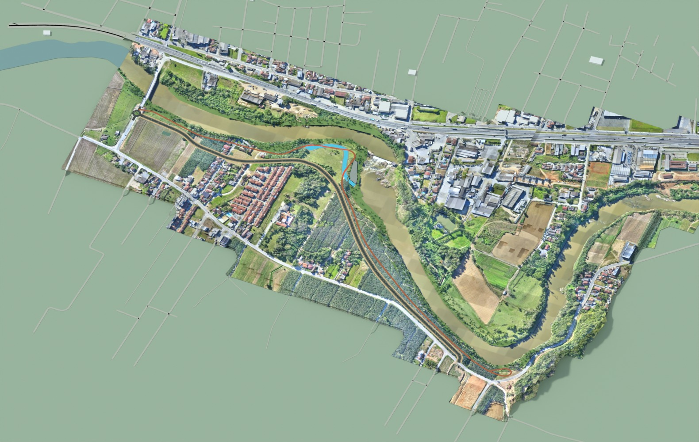
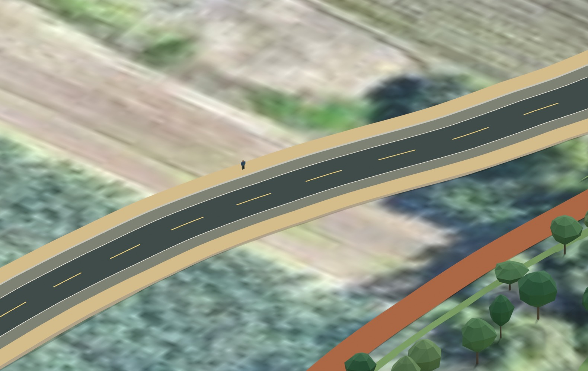
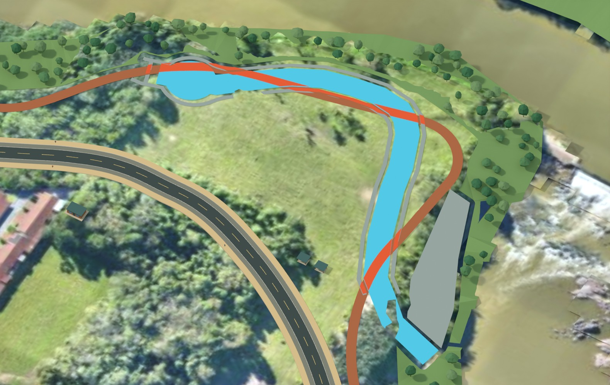

# Parque das Águas

### Experiência urbana interativa · Guaramirim, SC

Uma aproximação ao futuro parque linear às margens do **Rio Itapocu**, com exploração 3D, leitura da implantação e comparação entre o território existente e a proposta das **etapas 02 e 03**.

A experiência reúne a Via Parque, os percursos de micromobilidade, a paisagem das margens e a implantação do canal de canoagem slalom. Explore as relações entre o projeto e o entorno, consulte o programa de equipamentos e visualize os pontos de compatibilização.



[Conhecer o conceito](web/conceito.html) · [Explorar em 3D](web/explorar.html) · [Consultar o mapa técnico](web/index.html)

> Esses links apontam para os arquivos do repositório. Para navegar na experiência, abra a cópia local ou o endereço do GitHub Pages quando estiver habilitado.

## Explore o projeto

| Ambiente | O que você encontra |
| --- | --- |
| **Conceito** | Apresentação do parque, etapas, programa, gabaritos e imagens do estudo |
| **Maquete 3D** | Órbita, aproximação, câmeras temáticas e percursos pela via e pela micromobilidade |
| **Existente e proposta** | Comparação da base do levantamento com a implantação humanizada |
| **Equipamentos e layout** | Pinos vinculados ao programa da prancha R00 e aos volumes de estudo |
| **Mapa técnico** | Ortofoto, APP, cadastro, loteamentos e sobreposições em triagem |
| **Canoagem** | Leitura conjunta da implantação do canal e do percurso de micromobilidade |

### Uma cena, diferentes leituras

- **Realista** usa a ortofoto e os materiais da cena.
- **Monocromático** permite observar a composição em tons de cinza.
- **Cor sólida** simplifica as superfícies fotográficas para destacar a geometria.
- **Renderizado** acrescenta sombras dinâmicas e tratamento de exposição no navegador.

O painel permite alternar o céu, a arborização, os volumes do entorno, os equipamentos, a humanização e as referências técnicas.

## Via Parque e mobilidade

A seção viária representada atende ao gabarito de **18,00 m** informado para o estudo.

| Elemento | Largura |
| --- | ---: |
| Calçada | 3,00 m |
| Estacionamento | 2,50 m |
| Faixa de rolamento | 3,50 m |
| Faixa de rolamento | 3,50 m |
| Estacionamento | 2,50 m |
| Calçada | 3,00 m |
| **Total** | **18,00 m** |

O percurso de **micromobilidade tem 5,00 m de largura total**. A distribuição interna entre caminhada e bicicleta permanece em desenvolvimento.



A rotatória na Rua David Pacher foi representada com ilha central, acessos e encontro com a Via Parque. Sua geometria serve ao estudo visual da implantação. O dimensionamento dos giros, das travessias e das concordâncias requer desenvolvimento no projeto viário.

## Paisagem e equipamentos

O programa inclui áreas esportivas, espaço de meio ambiente, parcão, café e cultura, choupanas, sanitários, espaço das artes, parquinho, contemplação e canoagem.

Os pinos conectam o programa do masterplan aos volumes de estudo. Pessoas, veículos, mobiliário, gramado e arborização ajudam a observar a escala e as relações de uso. A proposta modelada se concentra nas etapas 02 e 03. A etapa 01 segue em consolidação.

As posições derivadas da prancha esquemática são indicativas. O ajuste visual apresentou desvios aproximados de 7 a 30 m nos pontos de controle. Alguns volumes foram reposicionados para evitar sobreposição com vias, água e outras geometrias. As posições precisam ser consolidadas na implantação técnica.

## Compatibilização da canoagem

O pré-projeto do canal foi sobreposto à base usando a ortofoto georreferenciada que acompanha seu desenho.



A análise preliminar encontrou **664,46 m² de sobreposição em planta** entre a faixa nominal de micromobilidade de 5 m e os quatro polígonos selecionados do canal e das áreas de intervenção. A faixa viária de 18 m passa fora desses polígonos.

Esse resultado orienta a revisão do percurso, dos acessos e das possíveis travessias. O registro espacial, a altimetria do canal e a solução hidráulica dependem da compatibilização das disciplinas.

A [tabela de interferências cadastrais](interferencias.csv) registra duas ocorrências de triagem da camada CAD PONTE, com aproximadamente 1,13 m² cada. A condição existente ou projetada dessas feições precisa ser confirmada no desenho de origem.

## Abrir no computador

1. Baixe este repositório pelo botão **Code → Download ZIP** ou clone com Git.
2. Extraia os arquivos mantendo a estrutura de pastas.
3. Abra o arquivo **index.html** da raiz para entrar na página de conceito.
4. Selecione **Explorar em 3D** ou **Mapa técnico**.

A versão incluída permite abertura local. Para servir por HTTP, execute na raiz com Python instalado.

```bash
python -m http.server 8000
```

Depois, abra http://localhost:8000 no navegador.

### Navegação na maquete

- Arraste para orbitar e use a roda do mouse para aproximar.
- Use o botão direito para deslocar o enquadramento.
- Em telas sensíveis ao toque, use um dedo para girar e dois para aproximar ou mover.
- Escolha **Planta**, **Gabarito**, **Rotatória** ou **Canoagem** para localizar setores.
- Selecione **Existente** ou **Proposta humanizada** para comparar os cenários.
- Use os pinos ou a lista de equipamentos para enquadrar cada setor.

O navegador precisa oferecer WebGL. O arquivo GLB tem aproximadamente **25 MB**, e o pacote JavaScript usado na abertura local ocupa aproximadamente **34 MB**. O tempo de carregamento varia conforme o aparelho e a conexão.

## Organização do repositório

```text
index.html                 Entrada da experiência
README.md                  Apresentação e orientação de uso
interferencias.csv         Ocorrências cadastrais em triagem
web/
  conceito.html            Página de conceito
  explorar.html            Visualizador 3D
  index.html               Mapa técnico
  explorar.mjs             Código-fonte do visualizador
  explorar.bundle.js       JavaScript preparado para o navegador
  parque.glb               Maquete exportada do Blender
  parque-modelo.js          Modelo e dados para abertura local
  camadas.js               Camadas geográficas do mapa
  *.css                    Estilos da interface
  *.jpg, *.png             Ortofoto, layout e imagens
```

A modelagem de origem foi desenvolvida no Blender. Este repositório reúne a experiência web e os ativos necessários à sua consulta.

## Bases e premissas

- **Terreno e ortofoto** provenientes do levantamento do parque.
- **Cadastro, APP e loteamentos** consolidados a partir das referências QGIS e CAD.
- **Eixos viários e de micromobilidade** extraídos do modelo InfraWorks R01.
- **Programa e etapas** interpretados da apresentação urbanística R00.
- **Canoagem** baseada no pré-projeto do canal e em sua ortofoto de referência.
- **Entorno** composto por dados OpenStreetMap e referências do InfraWorks, com alturas estimadas onde não havia informação.

A base espacial foi organizada em SIRGAS 2000 / UTM 22S, com origem local para a cena 3D. As cotas de apresentação, a arborização e os limites entre etapas são aproximados. A maquete apoia a exploração e a discussão do estudo preliminar. Implantação, acessibilidade, terraplenagem, estruturas e operação dependem dos respectivos projetos e validações.

## Tecnologias e créditos

**Three.js · WebGL · Blender · QGIS · InfraWorks · CAD**

O visualizador utiliza Three.js, com sua [licença distribuída junto aos arquivos](web/THREE-LICENSE.txt). Dados do entorno contêm **© OpenStreetMap contributors**, sob a [Open Database License](https://www.openstreetmap.org/copyright).

Os documentos e as imagens de projeto mantêm os créditos dos autores e das fontes originais.

[Mapa centralizado do projeto](https://amvaliprojetos12.github.io/parque-das-aguas/#16/-26.4787/-48.9842)
